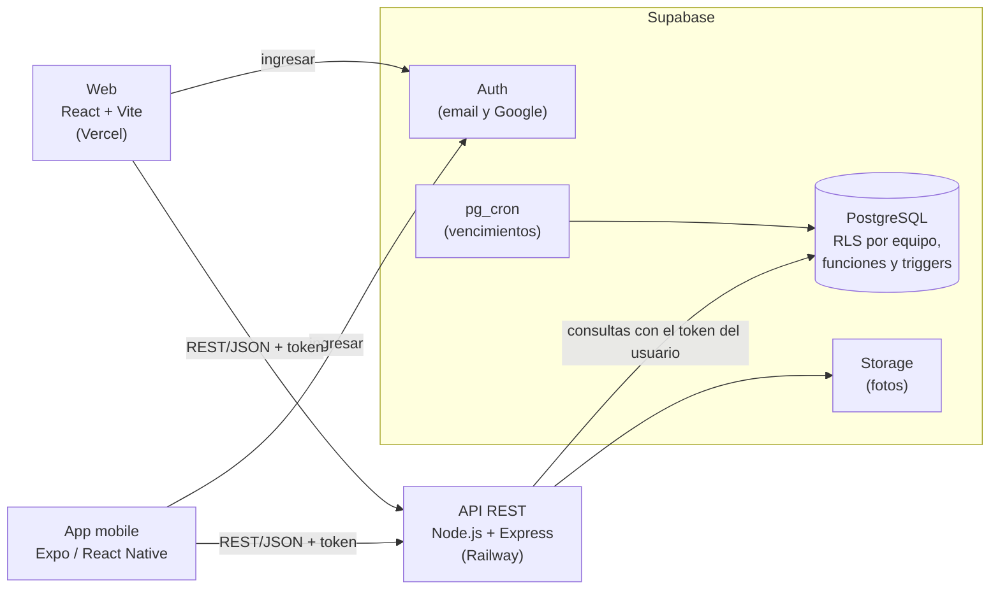

# Trackly

CRM y agenda comercial para equipos de ventas B2C chicos (3 a 15 personas) de rubros como educación,
estética o gimnasios. Ordena los contactos (leads) por urgencia, avisa antes de que venzan, registra
cada interacción y cierre, y le da al líder la vista de todo el equipo.

Proyecto final de la carrera Analista de Sistemas (Escuela Da Vinci). Autora: Abril Hayes.

- **Web:** https://trackly-six-delta.vercel.app
- **API:** https://trackly-production-6424.up.railway.app (`/api/health` responde si está en línea)
- **Prototipo navegable sin servidor:** [`docs/prototipos/trackly-prototipo.html`](docs/prototipos/trackly-prototipo.html)
- **App mobile:** ver [`mobile/README.md`](mobile/README.md)

## Qué hace

- **Mis leads** ordenados por urgencia (por vencer, sin contactar, sin próximo paso, esta semana, al día), con destacados.
- **Alertas de hoy** y **Agenda** (5 días, semana y mes) con los recordatorios manuales y los de cada contacto.
- **Tarjeta del contacto:** interés, historial automático, recordatorios, contacto por WhatsApp o Gmail con plantillas, varios emails, cierre ganado (con campos configurables) o perdido (con motivo).
- **Vencimiento automático** cada noche (días corridos o hábiles), **Archivo** para reclamar vencidos y reactivar archivados.
- **Charlas o eventos** con invitados y asistencia.
- **Líder:** ve todo el equipo con filtro por asesor, **Panel del equipo** con reasignación, **Estadísticas**, **Reportes personalizados** y **Configuración** (terminología del rubro, plazos, campos del cierre, motivos, miembros y licencias).
- **Importar contactos** desde Excel o CSV sin duplicados (mismo teléfono o email).
- Modo claro y oscuro, términos y política de privacidad (Ley 25.326).

## Arquitectura



- **Frontend** (`frontend/`): SPA en React. Las pantallas están en `src/pages`, los componentes en `src/components` y la lógica de negocio pura (urgencia, alertas, agenda, estadísticas, importar…) en `src/lib`, con tests. La pantalla y el contacto abierto quedan en la dirección (`#/agenda`, `#/leads/lead/<id>`).
- **Backend** (`backend/`): API REST en capas: `routes` → `controllers` → `services` → `lib`, con middleware de seguridad, autenticación y errores. **No usa clave de servicio:** cada pedido crea un cliente de Supabase con el token del usuario, así la base aplica sus reglas de seguridad (RLS) y un equipo nunca ve datos de otro.
- **Base de datos** (`database/`): PostgreSQL en Supabase. Las operaciones de negocio delicadas (cerrar, reclamar, reasignar, importar, licencias, vencimientos) son funciones SQL que validan equipo y rol y guardan el historial en la misma transacción. El esquema completo está en `database/esquema_completo.sql`.
- Más diagramas (clases, componentes, arquitectura) en [`docs/diagramas/`](docs/diagramas).

## Librerías principales

| Parte | Librerías |
|---|---|
| Web | React 19, Vite 8, Tailwind CSS 4, `@supabase/supabase-js`, Motion (animaciones de la página de bienvenida), PapaParse y read-excel-file (importar planillas), Inter (letra) |
| Backend | Express 5, `@supabase/supabase-js`, cors, dotenv |
| Mobile | Expo SDK 58, Expo Router, React Native, AsyncStorage, `@supabase/supabase-js` |
| Calidad | Vitest, `node:test`, ESLint, Prettier, GitHub Actions |

## Correrlo en la compu

**Requisitos:** Node.js 22 y Git. Un proyecto de Supabase con la base creada (ver más abajo).

```bash
git clone https://github.com/abrilhayes1/trackly.git
cd trackly
```

### 1. Base de datos (una sola vez)

En un proyecto nuevo de Supabase, abrir el **SQL Editor** y correr `database/esquema_completo.sql`
completo (crea tablas, reglas de seguridad, funciones, triggers, el bucket de fotos y la tarea de
cada noche). Detalle de cada script en [`database/LEEME.txt`](database/LEEME.txt).

En **Authentication**: activar email y contraseña (y Google si se quiere), y agregar la dirección de
la web en *URL Configuration*. Opcional: `database/seed_equipo_demo.sql` carga un equipo de prueba
(líder y 3 asesores; los usuarios están al principio de ese archivo).

Las licencias de cada equipo se cargan a mano:

```sql
update tenants set licencias = 15 where nombre = 'Nombre del equipo';
```

### 2. Backend

```bash
cd backend
cp .env.example .env      # completar las variables
npm install
npm run dev               # http://localhost:3000
```

| Variable | Qué es |
|---|---|
| `SUPABASE_URL` | URL del proyecto (Supabase → Project Settings → API) |
| `SUPABASE_ANON_KEY` | Clave **anon public** (nunca la `service_role`) |
| `FRONTEND_URL` | Dirección de la web publicada, para CORS (en la compu no hace falta) |
| `PORT` | Puerto (opcional, 3000 por defecto) |

### 3. Web

```bash
cd frontend
cp .env.example .env      # completar las variables
npm install
npm run dev               # http://localhost:5173
```

| Variable | Qué es |
|---|---|
| `VITE_SUPABASE_URL` | La misma URL del proyecto |
| `VITE_SUPABASE_ANON_KEY` | La misma clave anon public |
| `VITE_API_URL` | Dirección del backend publicado (en la compu no hace falta: usa `http://localhost:3000`) |

Si falta alguna variable, la web muestra cuál en lugar de quedar en blanco.

### Scripts

| Dónde | Comando | Qué hace |
|---|---|---|
| `frontend` | `npm run dev` / `npm run build` | Desarrollo / compilación para publicar |
| `frontend` | `npm test` | Tests (Vitest) |
| `frontend` | `npm run lint` / `npm run formato` | ESLint / Prettier |
| `frontend` | `npm run prototipo` | Genera `docs/prototipos/trackly-prototipo.html` (la app con datos de ejemplo, en un solo archivo) |
| `backend` | `npm run dev` / `npm start` | Servidor con recarga / servidor |
| `backend` | `npm test` | Tests (`node:test`) |

## Publicación

- **Web:** Vercel, carpeta raíz `frontend`, con las tres variables `VITE_…`.
- **Backend:** Railway, carpeta raíz `backend`, con `SUPABASE_URL`, `SUPABASE_ANON_KEY` y `FRONTEND_URL`.
- Cada push a `main` dispara **GitHub Actions** (`.github/workflows/chequeo.yml`): tests, lint, formato y build de la web y el backend, y compilación de la app mobile. Vercel y Railway publican la versión nueva solos.

## Buenas prácticas aplicadas

- **Git:** historial con mensajes descriptivos en castellano y chequeo automático en cada push.
- **Capas separadas:** en el backend, rutas → controladores → servicios → utilidades; en la web, páginas, componentes y lógica de negocio pura en `src/lib`, reutilizada también por la app mobile.
- **Código limpio:** ESLint y Prettier en todo el proyecto, nombres en castellano y comentarios que explican el porqué. La lógica que decide (urgencia, alertas, agenda, licencias…) está fuera de los componentes y tiene tests (72 en total). Los componentes más grandes (tarjeta del contacto, panel del equipo) son candidatos a dividirse.
- **Variables de entorno:** todo lo que cambia entre la compu y la publicación va en `.env` (ignorado por Git), con un `.env.example` en cada carpeta.
- **Sin secretos en el repositorio:** solo se usa la clave pública (anon) de Supabase; el backend no tiene clave de servicio y los permisos los decide la base con el token de cada usuario.
- **Validación de datos:** en la web (formularios), en el backend (tipos, formatos, largos y fechas, con mensajes claros) y en la base (funciones y triggers: contactos repetidos, campos obligatorios del cierre, licencias, permisos por rol).
- **Seguridad:** RLS en las 12 tablas, encabezados de seguridad, límite de pedidos, cierre de sesión por inactividad y errores técnicos que no llegan al usuario.

## Estructura

```
trackly/
├── frontend/     web (React + Vite)
├── backend/      API REST (Express)
├── mobile/       app mobile (Expo)
├── database/     scripts SQL y esquema completo
└── docs/         resumen técnico, diagramas, prototipos y diseño
```
